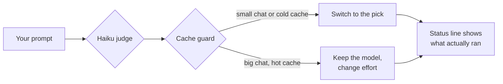

<div align="center">

# ⚖️ right-size

**The right model and the right effort for every prompt. Automatically.**

Easy questions stop burning Opus at max effort. Hard problems still get the heavy hitter.


```
sonnet · medium
```

*That's the whole interface.*

</div>

---

## ✨ What it does

Before each turn, a quick Haiku call reads your prompt and picks a model and an effort level. A cache guard then checks whether switching models is worth it: in a big chat with a hot cache, it keeps the current model and changes effort only. The result applies to every model request in that turn, and one status line under the prompt tells you what ran.

No panels. No bars. No settings screens. No eye cancer.

## 🔀 How it works



| You type                          | right-size picks      |
| --------------------------------- | --------------------- |
| "rename `x` to `y` in this file"  | 🟢 haiku              |
| "fix the failing test"            | 🟡 sonnet · medium    |
| "redesign the auth flow"          | 🔴 opus · high        |

## 📏 Rules

| | |
| --- | --- |
| 💬 **Short replies keep the last pick** | "ok", "go", "yes" and friends skip the judge call. |
| ⌨️ **Slash commands pass through** | Commands and hidden prompts are never judged. |
| 🤖 **Subagents are left alone** | Only your main conversation is routed. |
| 🛟 **Safe fallback** | If the judge fails or rambles, your session's own model and effort run, and the status line says so. |
| 🧊 **Cache guard** | In a big chat whose cache is still hot, the model stays put and only effort changes. See below. |

## 🔍 Trust, but verify

The status line comes from the API's own usage data, not from what the mod *asked* for. If the engine didn't honor the request, you'll know:

```
sonnet · medium (ran claude-opus-5-5)
```

> [!NOTE]
> `/model` keeps showing your session's model. right-size changes each request, not that setting. And asking Claude "which model are you?" won't tell you either: the system prompt names the session's model.

## 📦 Install

Not published yet. Install it from a local copy of this folder:

```bash
claude plugin marketplace add <path to this folder>
claude plugin install right-size@right-size --scope user
```

It then runs in every terminal session and in the desktop app's local sessions. Edits to the folder take effect after `/reload-plugins`.

## 🎛️ Tuning

Everything lives in [`hooks/register.ts`](hooks/register.ts):

| Constant | What it controls |
| --- | --- |
| `SYSTEM` | The judge's instructions. Edit it to change how eagerly it picks bigger models. |
| `IDS` | Which model id each pick maps to. |
| `FOLLOW_UP` | The pattern for replies that skip the judge. |
| `CACHE_TTL_MS` | How long a model's cache counts as hot after its last request. 1 hour by default; set 5 minutes if your account uses the API's default cache. |
| `SMALL_CONTEXT_TOKENS` | Below this context size (40k tokens by default), switching models is always allowed. |

## 🧊 The cache guard

Each model keeps its own prompt cache. Switching models means the new one re-reads the whole chat at full price, which in a long chat costs more than the cheaper model saves.

So before each turn, right-size checks two things:

| Chat size | Current model's cache | Result |
| --- | --- | --- |
| small | any | 🔀 switch to the pick |
| big | cold | 🔀 switch to the pick: re-reading is due anyway |
| big | hot | 📌 stay on the current model, change effort only |

The model is decided once per turn, so tool calls inside a turn never switch. When the guard holds, the status line says so:

```
opus · low (kept: cache hot)
```

Chat size comes from the session's live context figures. Before the first reply of a session (or right after compaction), the size is unknown and counts as small.

## 💸 Costs

Each prompt makes one small Haiku call (low effort, 16 output tokens max, 5-second limit). The cache guard keeps model switches to the moments where they're cheap.

## 🛠️ Development

```bash
claude plugin validate .
claude plugin test .
```

The tests cover the pick, the cache guard (hot, cold, small chat) and the judge-failure fallback with mocked events. They don't exercise a live session.

---

<div align="center">
<sub>Built as a calmer take on <a href="https://github.com/HeyCubit/effortless">effortless</a>.</sub>
</div>
